

<!-- Dark Spruce & Amber Research Dossier Header (synced with sanchitkrai.me) -->

  

  
  
  
  

  

<!-- Compact Bento Overview: 3D Avatar GIF + Telemetry Card -->
<table>
  <tr>
    <td width="35%" align="center" valign="middle">
      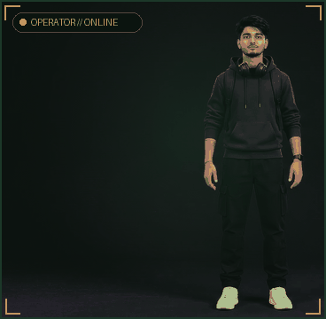
    </td>
    <td width="65%" valign="middle">
      
    </td>
  </tr>
</table>

## 🏆 Hackathons & Competitive Builds

<!-- Animated SVG cards generated by gen_assets.py -->

<table>
<tr>
<td width="50%" align="center">
  <a href="https://rr-chi-taupe.vercel.app"></a>
   
  <a href="https://rr-chi-taupe.vercel.app">Live Dashboard</a> · <a href="https://github.com/SanchitKRai/RR-auction">GitHub Repo</a> · Rajasthan Royals (Unstop) · Submitted
</td>
<td width="50%" align="center">
  <a href="https://type2diabetes-digitaltwin.streamlit.app/"></a>
   
  <a href="https://type2diabetes-digitaltwin.streamlit.app/">Streamlit App</a> · <a href="https://github.com/SanchitKRai/Type2Diabetes-DigitalTwin">GitHub Repo</a> · Happiest Health (Unstop) · Submitted
</td>
</tr>
<tr>
<td width="50%" align="center">
  <a href="https://github.com/SanchitKRai/future-health-male-triage"></a>
   
  <a href="https://future-health-male-triage.streamlit.app/">Legacy Demo</a> · <a href="https://github.com/SanchitKRai/future-health-male-triage">GitHub Repo</a> · Future Health Digital Innovation · Submitted
</td>
<td width="50%" align="center">
  <a href="https://github.com/SanchitKRai/BIOVERSE"></a>
   
  <a href="https://github.com/SanchitKRai/BIOVERSE">GitHub Repo</a> · Three.js WebGL · UniProt, RCSB PDB &amp; Reactome
</td>
</tr>
</table>

| Hackathon / Challenge | Host / Platform | Project | Deadline / Round | Status |
|---|---|---|---|---|
| 🏏 **SupeRR Selector Season 2** *(IPL 2027)* | Rajasthan Royals *(Unstop)* | [RR War Room](https://github.com/SanchitKRai/RR-auction) · [Live](https://rr-chi-taupe.vercel.app) | Nov 16, 2026 | Submitted |
| 🩺 **Digital Twin Challenge 2026** | Happiest Health *(Unstop)* | [Type 2 Diabetes Digital Twin](https://github.com/SanchitKRai/Type2Diabetes-DigitalTwin) · [Live](https://type2diabetes-digitaltwin.streamlit.app/) | Oct 18, 2026 | Submitted |
| 🛡️ **Future Health Digital Innovation** | Hack2skill *(Hybrid)* | [LOC — Men's Health Check](https://github.com/SanchitKRai/future-health-male-triage) | Nov 20, 2026 | Submitted |
| 🧬 **College Society Challenge** | University Challenge | [BIOVERSE](https://github.com/SanchitKRai/BIOVERSE) | Oct 2026 | Built |
| 🏥 **Build 2036** | TiE Global Summit 2026 *(Hybrid)* | [Healthspan Passport](https://github.com/SanchitKRai/Healthspan-Passport) · [Live](https://frontend-tau-murex-6pqd8vtg90.vercel.app) | Nov 30, 2026 | Building |
| 🎙️ **Build with Google Gemini** | Google / Hack2skill *(Virtual)* | **VyaparFlow** — *Voice-Driven Agentic Workflow Automation* | Dec 03, 2026 | Building |

## 🚀 Featured Projects & Active Builds

<table>
<tr>
<td width="50%" align="center">
  <a href="https://frontend-tau-murex-6pqd8vtg90.vercel.app"></a>
   
  <a href="https://frontend-tau-murex-6pqd8vtg90.vercel.app">Live App</a> · <a href="https://github.com/SanchitKRai/Healthspan-Passport">GitHub Repo</a> · Building for Build 2036
</td>
<td width="50%" align="center">
  
   
  Build with Google Gemini (Virtual) · Voice-Driven Agentic Workflow Automation
</td>
</tr>
<tr>
<td width="50%" align="center">
  <a href="https://dataarena-one.vercel.app"></a>
   
  <a href="https://dataarena-one.vercel.app">Live App</a> · <a href="https://github.com/SanchitKRai/Data-arena">GitHub Repo</a>
</td>
<td width="50%" align="center">
  <a href="https://docklens-bioedge.streamlit.app/"></a>
   
  <a href="https://docklens-bioedge.streamlit.app/">Streamlit App</a> · <a href="https://github.com/SanchitKRai/Docklens">GitHub Repo</a>
</td>
</tr>
<tr>
<td width="50%" align="center">
  <a href="https://github.com/SanchitKRai/EV-Charging-Analytics"></a>
   
  <a href="https://github.com/SanchitKRai/EV-Charging-Analytics">GitHub Repo</a> · Time Series &amp; Power BI
</td>
<td width="50%" align="center">
  <a href="https://nyc-room-type-predictor-gpjz.onrender.com/"></a>
   
  <a href="https://nyc-room-type-predictor-gpjz.onrender.com/">Live App</a> · <a href="https://github.com/SanchitKRai/NYC_room_type-predictor">GitHub Repo</a>
</td>
</tr>
</table>

### 🧫 More work from my project lab

| Project | What it explores | Links |
|---|---|---|
| 🧬 **BioEdge India** | Interactive bio tools, DNA toolkit, learning resources &amp; live IndiaBioscience hackathon/event radar | [Live site](https://bioedgeindia.vercel.app/) · [Repo](https://github.com/SanchitKRai/Bioedgeindia) |
| 🔬 **Genome Explorer AI** | 3D double-helix visualizer, 6-frame ORF scanner, point-mutation simulator &amp; AI tutor (FastAPI + R3F) | [Repo](https://github.com/SanchitKRai/Genome-explorer) |
| 🛡️ **LOC — Private Men's Health Check** | Privacy-first rules-driven clinical triage &amp; navigation (FastAPI + React/TS; legacy XGBoost/TreeSHAP demo) | [Legacy demo](https://future-health-male-triage.streamlit.app/) · [Repo](https://github.com/SanchitKRai/future-health-male-triage) |
| 💊 **Pharmacogenomics Explainer** | Browser-side 23andMe, AncestryDNA &amp; VCF parser with CPIC and dbSNP marker context | [Repo](https://github.com/SanchitKRai/Pharmacogenomics-explainer) |
| 📚 **textbook-docx_skill** | Agent Skill &amp; Python CLI (`v3.0.0`) converting Markdown + LaTeX math into formatted Word textbooks | [Repo](https://github.com/SanchitKRai/textbook-docx_skill) |
| 🧪 **MIP (Mutation Impact Predictor)** | Interactive mutation impact prediction web app | [Live app](https://mip-rouge.vercel.app) · [Repo](https://github.com/SanchitKRai/MIP) |
| 🧬 **GeneScope Web** | DNA sequence utilities, ORF detection, alignment, GC content, and primer analysis | [Live app](https://dna-sequence-analyzer-gamma.vercel.app/) · [Repo](https://github.com/SanchitKRai/dna-sequence-analyzer) |
| 🧭 **NextUp &amp; DataLens Insights** | Career roadmap explorer (`NextUp`) and client-side data profiling &amp; insights (`DataLens`) | [NextUp](https://pathfinder-forge-drab.vercel.app/) · [DataLens](https://datalens-insights.lovable.app/) |
| 👥 **HR Attrition &amp; SmartDelivery360** | HR KPI &amp; RLS analytics (Microsoft Fabric / Power BI) and delivery operations notebook | [HR Attrition](https://github.com/SanchitKRai/HR-attrition-analysis) · [SmartDelivery360](https://github.com/SanchitKRai/SmartDelivery360) |
| 🌐 **Sanchit Portfolio** | Personal portfolio with generative telemetry waveforms, case studies &amp; Web Audio soundscape | [sanchitkrai.me](https://www.sanchitkrai.me/) · [Repo](https://github.com/SanchitKRai/Sanchit-portfolio) |

## 🧰 Toolkit

  

**Data Science, ML &amp; Clinical AI** 

**Full-Stack, 3D &amp; Data Platforms** 

**Data Analytics &amp; Life Sciences** 

## 📊 GitHub at a glance

  
  
    
  
    
  

### 🐍 Contribution snake

<picture>
  <source media="(prefers-color-scheme: dark)" srcset="https://raw.githubusercontent.com/SanchitKRai/SanchitKRai/output/github-contribution-grid-snake-dark.svg" />
  
</picture>

  

## 🌱 Focus & Principles

- Building stronger foundations in statistics, model evaluation, and feature engineering.
- Shipping end-to-end projects with reproducible analysis, clean documentation, and usable interfaces.
- Connecting analytics, full-stack engineering, and ML with healthcare and life-sciences problems—without overstating what a prototype can prove.

### `DATA → MODELS → INSIGHTS → IMPACT`

Dark Spruce &amp; Amber Research Dossier · <a href="https://www.sanchitkrai.me/">sanchitkrai.me</a> ✨

